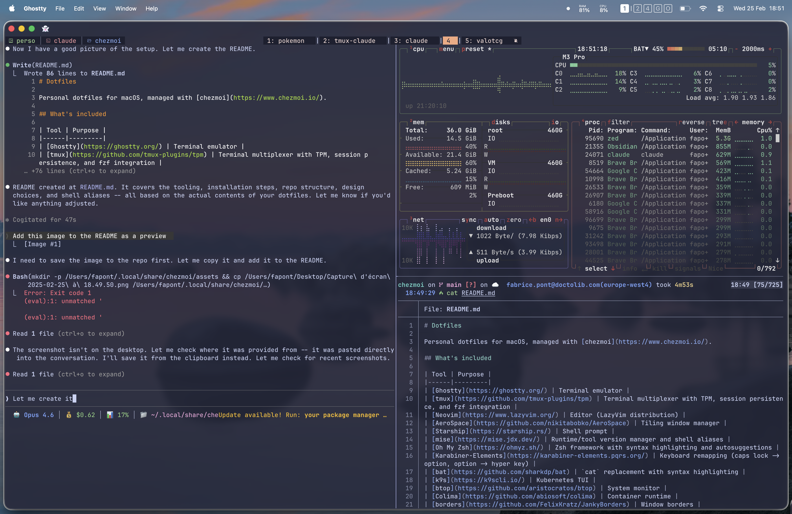

# Dotfiles

Personal dotfiles for a macOS work laptop and an [Omarchy](https://omarchy.org)
(Arch + Hyprland) personal laptop, bootstrapped entirely by
[mise](https://mise.jdx.dev/). No Homebrew, no chezmoi.



## Install

Same steps on macOS and Omarchy:

```sh
command -v mise || curl https://mise.run | sh   # Omarchy already ships mise
export PATH="$HOME/.local/bin:$PATH"
MISE_AUTO_ENV=1 mise bootstrap --from https://github.com/fapont/dotfiles.git --from-dir ~/.dotfiles --yes --force-dotfiles
```

```sh
cd ~/.dotfiles
mise run setup-github-ssh    # SSH key for GitHub auth + commit signing
bw login
mise run restore-secrets     # fnox age key from Bitwarden
mise run setup-obsidian      # Obsidian vault + LiveSync
```

The OS picks the [dotfile groups](#how-it-works); `--force-dotfiles` replaces
the configs Omarchy pre-seeds. Afterwards, re-run a plain `mise bootstrap` from
`~/.dotfiles`. On macOS, a few [permissions](#macos-permissions) stay manual.

## Layout

```
mise.toml                   # repo clones, dotfile groups and the dotfiles map (what goes where)
mise.macos.toml             # dotfile groups on macOS
mise.linux.toml             # dotfile groups on Linux
mise/
  config.toml               # -> ~/.config/mise/config.toml
  conf.d/                   # -> ~/.config/mise/conf.d/, one fragment per domain
    tools.toml              #    CLI tools
    shell.toml              #    aliases, env, login shell
    history.toml            #    ~/.zshrc blocks
    macos.toml              #    macOS packages + system defaults
    omarchy.toml            #    Arch packages + Omarchy theme
    agents/                 #    AI agent CLIs, AGENTS.md, Claude settings fragments
    obsidian/               #    Obsidian app + setup-obsidian task
  tasks/                    # `mise run` tasks: restore-secrets, setup-github-ssh, setup-git-identity
config/                     # group `config`: shared app configs (git, ghostty, nvim, btop, starship...)
macos/                      # group `macos`: aerospace, karabiner, vorssaint, colima
omarchy/                    # group `omarchy`: Hyprland overrides, default terminal
work/                       # group `work`: k9s + mise/conf.d/work.toml (k8s, Docker, AWS, GCloud)
```

## How it works

- **Dotfile groups**: `config/`, `macos/`, `omarchy/` and `work/` are linked file
  by file into `~/.config`. `mise.macos.toml` picks `config` + `macos` + `work`,
  `mise.linux.toml` picks `config` + `omarchy`, loaded through `MISE_AUTO_ENV=1`
  (exported by `shell.toml`). Without it, every group applies.
- **Two OSes, one config**: `brew` entries are `os = "macos"`, `pacman`/`aur`
  ones are skipped where missing, and CLIs Omarchy already ships (jq, bat, eza,
  fd, ripgrep...) are macOS-only in `tools.toml`.
- **Omarchy extras**: missing Arch packages, Ghostty as default terminal (with
  a Linux-sized font, `omarchy/ghostty/omarchy.conf`),
  Catppuccin applied once, Hyprland overrides in `omarchy/hypr/` (AZERTY,
  natural scroll, rounded corners, blur), and closing the lid locks instead
  of suspending (logind drop-in), so the laptop stays reachable.
- **mise fragments**: `mise/conf.d/` is split by domain and linked file by file,
  so untracked machine-local fragments (e.g. `doctolib.toml`) can sit alongside.
  A domain with scripts becomes a folder fragment (see `conf.d/obsidian/`).
- **Symlinks**: app configs are symlinked, so edits are live and show up in
  `git status`. `~/.gitconfig` stays untracked for `git config --global` writes.
  `~/.zshrc` is tracked by mise through marker blocks (`mise dot status`/`diff`/`save`).

## Notable choices

- **Git identity**: work email by default, personal one under `~/Perso/`, in this
  repo or for `fapont/*` remotes. Emails stay out of the repo (asked once by
  `setup-git-identity`). Commits are SSH-signed with the per-machine key.
- **Supply-chain cooldown**: `minimum_release_age = "3d"`; pin a version to bypass.
- **AI agents** (`mise/conf.d/agents/`): one `AGENTS.md` linked for each agent.
  Claude's `settings.json` isn't tracked; fragments in `agents/claude/settings.d/`
  are merged into it (`merge = true` enforces, `"missing"` only sets defaults;
  arrays are replaced, and removed keys stay live).
  User-scope MCP servers (`agents/claude/mcp.json`) are merged into `.claude.json`
  the same way, their URL and key as `${VAR}`s from fnox.
- **Secrets**: `config/fnox/config.toml`, age-encrypted in the repo, decrypted locally.

## Day to day

- New tool or package: edit the relevant `conf.d/*.toml`, `mise bootstrap`, commit.
- New file in a group or in `conf.d/`: `mise bootstrap --only dotfiles`.
- Preview anything with `mise bootstrap --dry-run`.

## macOS permissions

Not scriptable: grant in **System Settings > Privacy & Security**, then restart the app.

- **Accessibility**: AeroSpace, Ice, Raycast, Karabiner-Elements, Vorssaint.
- **Screen Recording**: Raycast, Ice (again after each update), Vorssaint.
- **Vorssaint settings**: import `macos/vorssaint/settings.plist` by hand.
- **Karabiner**: approve its driver in **Login Items & Extensions**, then reboot
  for the hyper key to work.
- **Login items**: Ice is added by bootstrap; AeroSpace, Raycast, Bitwarden and
  Karabiner handle it themselves; Brave by hand.

## Known gaps

- Omarchy's `mise use -g` wrappers and `omarchy-reinstall-configs` write through
  the symlinks into this repo: check `git status`.
- Colima's VM state lives (gitignored) in `macos/colima/`: stop the VM before moving it.
- A past `sudo mise` can leave root-owned files in `/opt/homebrew`:
  `sudo chown -R "$(whoami)":admin /opt/homebrew`.
